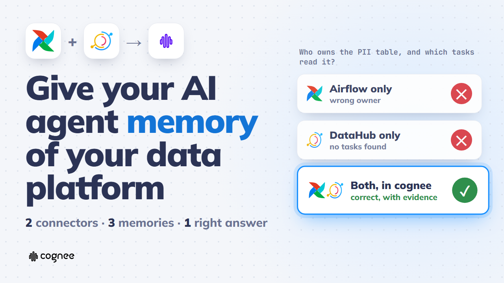
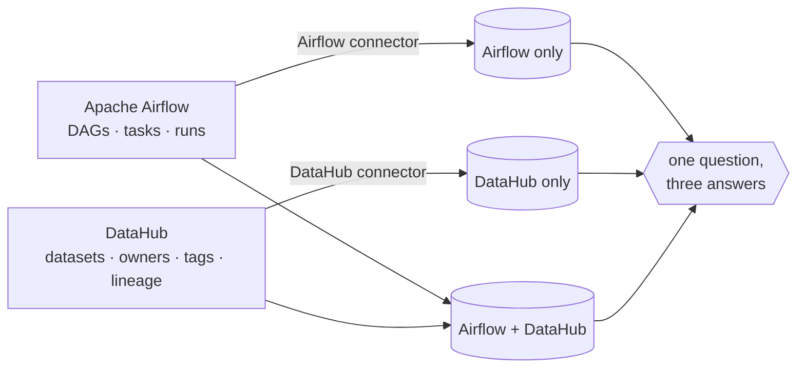
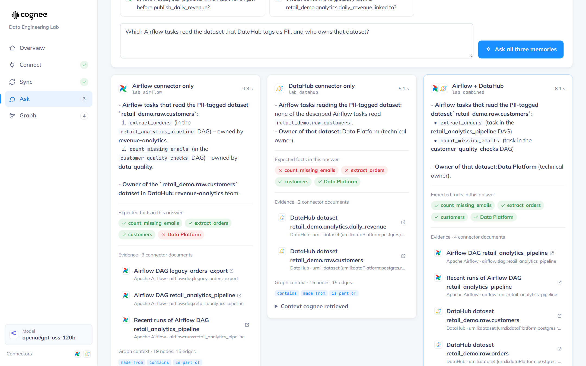
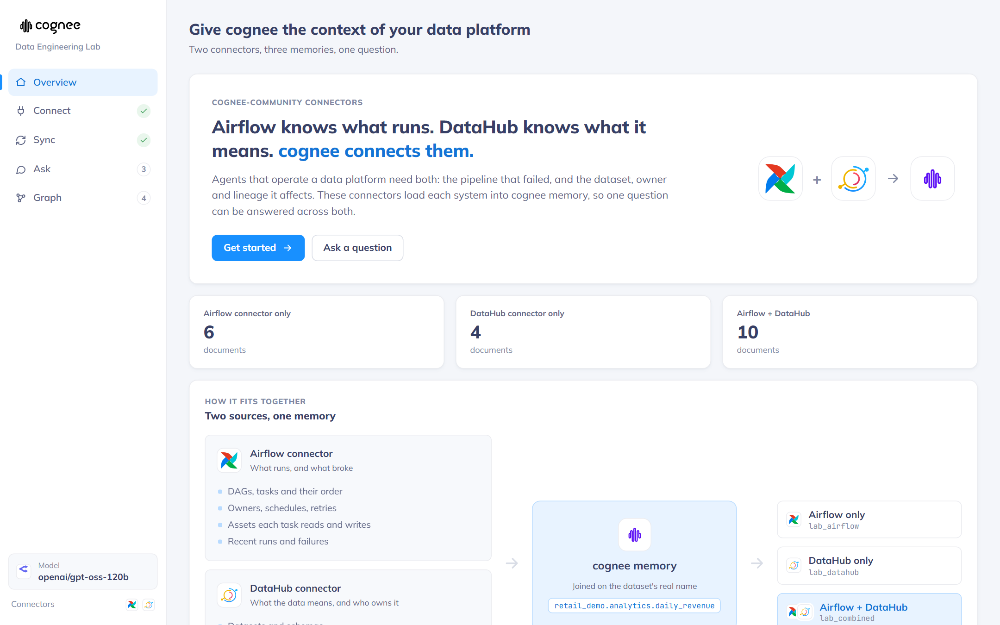
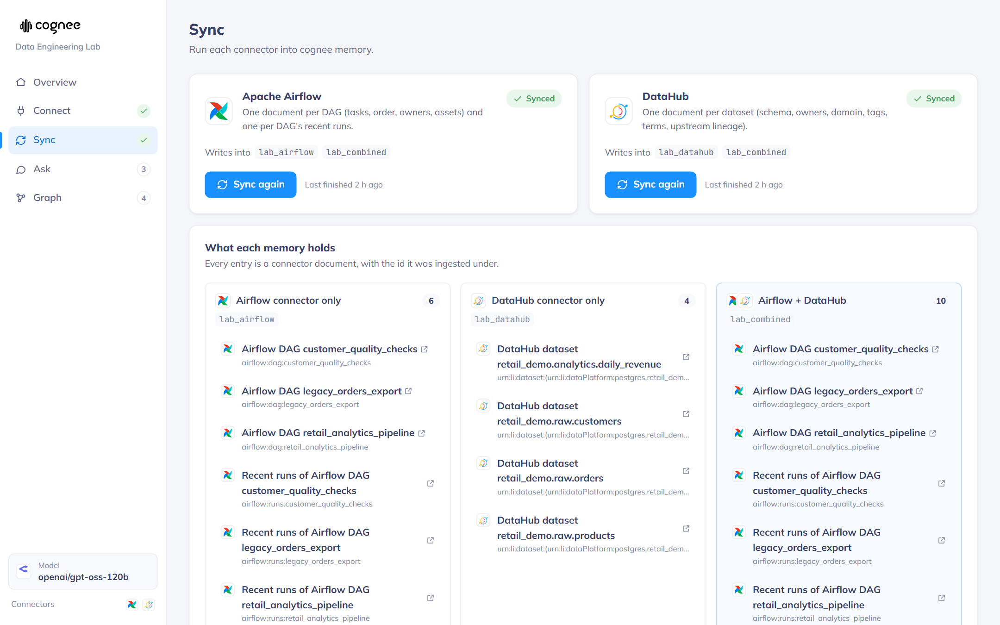
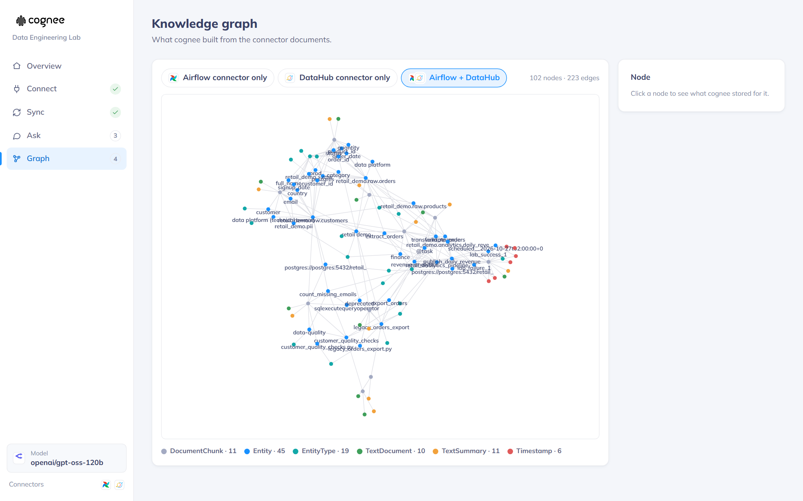

<p align="center">
  
  &nbsp;&nbsp;&nbsp;
  
  &nbsp;&nbsp;&nbsp;
  
</p>

<h1 align="center">cognee Data Engineering Lab</h1>

<p align="center">
  <b>Give cognee the context of your data platform.</b><br />
  Two cognee connectors (Apache Airflow and DataHub), and a lab that shows what they unlock together.
</p>

<p align="center">
  <a href="https://youtu.be/9-4LVBFVDww"></a><br />
  <a href="https://youtu.be/9-4LVBFVDww"><b>▶ Watch the demo (2:46)</b></a>
  &nbsp;·&nbsp;
  <a href="https://jishanahmedshaikh.medium.com/connecting-airflow-and-datahub-to-cognee-building-memory-across-a-data-platform-1892d6ded364"><b>Read the write-up</b></a>
</p>

---

> **About this repo.** This is the working proof behind two feature requests I opened on cognee:
> [Apache Airflow data-source connector (#5359)](https://github.com/topoteretes/cognee/issues/5359) and
> [DataHub data-source connector (#5360)](https://github.com/topoteretes/cognee/issues/5360).
> Rather than describe the connectors in an issue, I built both, tested them against real Airflow and
> DataHub instances, and built this lab so reviewers can run them end to end and see what each one adds,
> alone and together. The connector packages are what I propose for cognee-community. The lab is a
> companion for evaluating them, not part of the proposal.

## Why

A pipeline fails at 2 a.m. *Which task broke* is in Airflow. *Who owns the table, and whether it holds
personal data,* is in DataHub. An AI agent with neither has nothing to work with. An agent with only one
of them answers half the question.

These connectors bring both into [cognee](https://github.com/topoteretes/cognee) memory:

| Connector | Source | What cognee learns |
|---|---|---|
| [`connectors/airflow`](connectors/airflow) | Apache Airflow 3.x REST API | DAGs, tasks, dependencies, owners, schedules, task inlets and outlets (Assets), recent runs and failures |
| [`connectors/datahub`](connectors/datahub) | DataHub GraphQL API | datasets, schemas, owners, domains, tags, glossary terms, upstream lineage |

**They join on facts, not guesses.** An Airflow task's outlet asset (`postgres://…/retail_demo/analytics/daily_revenue`)
and the DataHub URN (`urn:li:dataset:(…postgres,retail_demo.analytics.daily_revenue,PROD)`) are both written
as the same identifier, `retail_demo.analytics.daily_revenue`, so cognee links them explicitly.

Both connectors are **read-only**. They follow the
[cognee-community](https://github.com/topoteretes/cognee-community) connector layout: a `<name>_source()`
factory returns a dlt resource you hand to `cognee.remember(...)`. Every sync is a full snapshot: new
documents are remembered and documents deleted at the source are forgotten. The lab uses the published
`cognee` package; cognee itself is not modified.

## What the lab shows

The lab syncs each connector into its own memory, plus a third memory that holds both, then asks all three
the same question.



> *Which Airflow tasks read the dataset that DataHub tags as PII, and who owns that dataset?*

| Memory | Tasks that read it | Owner |
|---|---|---|
| Airflow only | `extract_orders`, `count_missing_emails` | ✕ wrong (it can't see DataHub ownership) |
| DataHub only | ✕ none found (it can't see Airflow tasks) | Data Platform |
| **Airflow + DataHub** | **`extract_orders`, `count_missing_emails`** | **Data Platform** |

Across the lab's five built-in questions, only the combined memory retrieved every expected fact in our
runs. Each answer lists its evidence: the connector documents it used, linked back to the exact Airflow DAG
and DataHub dataset.

<p align="center"></p>

<details>
<summary>More screenshots</summary>

| Overview | Sync |
|---|---|
|  |  |

<p align="center"></p>
</details>

## Quick start

You need Docker. The AI model is bring-your-own-key: OpenAI, Anthropic, Gemini, Groq, OpenRouter or a
local Ollama, entered in the app.

```bash
git clone https://github.com/jars-demo/cognee-data-lab.git
cd cognee-data-lab
docker compose up -d --build     # http://localhost:8765
```

Then work through the app:

1. **Connect:** choose an AI provider and model, then *Save and test* your Airflow 3.x and DataHub.
2. **Sync:** run each connector into memory.
3. **Ask:** ask one question of all three memories and compare the answers and their evidence.
4. **Graph:** explore the knowledge graph cognee built.

The lab runs in a container, so `localhost` there is the container itself. For an Airflow or DataHub on
your machine, use `http://host.docker.internal:<port>`. Remote instances use their normal URL. You can
narrow the scope on the Connect page: a DAG pattern or tags for Airflow, platforms or domains for DataHub.

### With the demo data

No Airflow handy? The `demo` profile adds Airflow 3.3 with three DAGs over a synthetic retail warehouse.
DataHub is still yours (your own, or `datahub docker quickstart`) with token auth enabled.

```bash
cp .env.example .env              # optional: pre-fills the Connect page (DataHub URL + token)
docker compose --profile demo up -d --build
./seed/airflow_runs.sh            # one successful run and one controlled failure
./seed/seed_datahub.sh            # catalogs the warehouse in DataHub: owners, tags, terms, lineage
```

| Service | Address | Contents |
|---|---|---|
| The lab | **http://localhost:8765** | the app |
| Airflow 3.3 | http://localhost:8088 (`admin` / `admin`) | `retail_analytics_pipeline`, `customer_quality_checks`, `legacy_orders_export` |
| Postgres | `localhost:5433` | `raw.orders`, `raw.customers`, `raw.products`, `analytics.daily_revenue` |

[seed/README.md](seed/README.md) explains what is seeded and how the two systems link.

> **Tip:** a free-tier key can hit rate limits while cognee builds the graph. Set
> `LLM_RATE_LIMIT_ENABLED=true`, `LLM_RATE_LIMIT_REQUESTS=20` and `LLM_RATE_LIMIT_INTERVAL=60` on the
> `lab` service to throttle it.

## Use the connectors on their own

Each connector is a standalone package with its own README, tests and example:

```python
import cognee
from cognee_community_connector_airflow import airflow_source
from cognee_community_connector_datahub import datahub_source

airflow = airflow_source(base_url="http://localhost:8088", username="admin", password="…", include_runs=True)
datahub = datahub_source(base_url="http://localhost:8080", token="…", platforms=["postgres"])

# max_rows_per_table=0: no row cap, so forget-on-delete only removes what the source deleted.
await cognee.remember(airflow, dataset_name="platform", max_rows_per_table=0)
await cognee.remember(datahub, dataset_name="platform", max_rows_per_table=0)
```

See [connectors/airflow](connectors/airflow) and [connectors/datahub](connectors/datahub) for every
option, the document format and how deletes are handled.

## Repository layout

```
connectors/airflow   cognee-community-connector-airflow  (package, tests, example)
connectors/datahub   cognee-community-connector-datahub  (package, tests, example)
app/backend          the lab API: FastAPI + cognee + both connectors
app/frontend         the lab UI: Vite + TypeScript
infra/               demo Airflow DAGs and the Postgres warehouse they run on
seed/                catalogs the demo warehouse into DataHub, and removes it again
docker-compose.yml   the lab, plus the opt-in demo Airflow (profile "demo")
```

## Develop

You need Python 3.11 with [uv](https://docs.astral.sh/uv/) and Node 20.19+ (or 22.12+).

```bash
cd app/frontend && npm install && npm run build   # the backend serves app/frontend/dist
cd ../backend && uv sync && ./run-local.sh        # http://localhost:8765
```

For UI work, run `npm run dev` in `app/frontend` (http://localhost:5173); it proxies `/api` to the backend.
Connector tests: `uv run pytest -m "not live"` in either connector folder (the live tests need real services).

## Cleanup

```bash
docker compose run --rm seed python cleanup_datahub.py --yes   # removes only the lab's DataHub entities
docker compose --profile demo down -v                           # removes the lab memory, demo Airflow and Postgres
```

## Status

| Connector | Issue | Tests |
|---|---|---|
| `cognee-community-connector-airflow` | [#5359](https://github.com/topoteretes/cognee/issues/5359) | 17 unit and sync tests, plus opt-in live tests (`-m live`) |
| `cognee-community-connector-datahub` | [#5360](https://github.com/topoteretes/cognee/issues/5360) | 13 unit and sync tests, plus opt-in live tests (`-m live`) |

Both are proposed for cognee-community, one pull request per issue. Feedback on the document format,
the shared dataset identifier and the scoping options is very welcome on the issues.

## License

[Apache License 2.0](LICENSE), the same as cognee-community.
